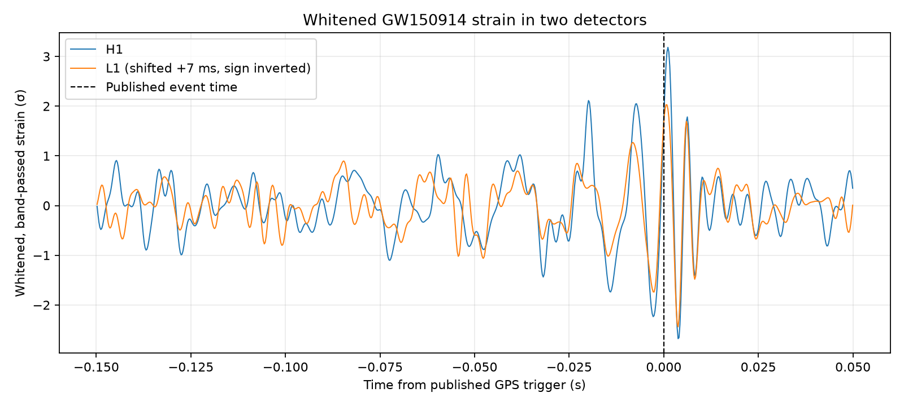
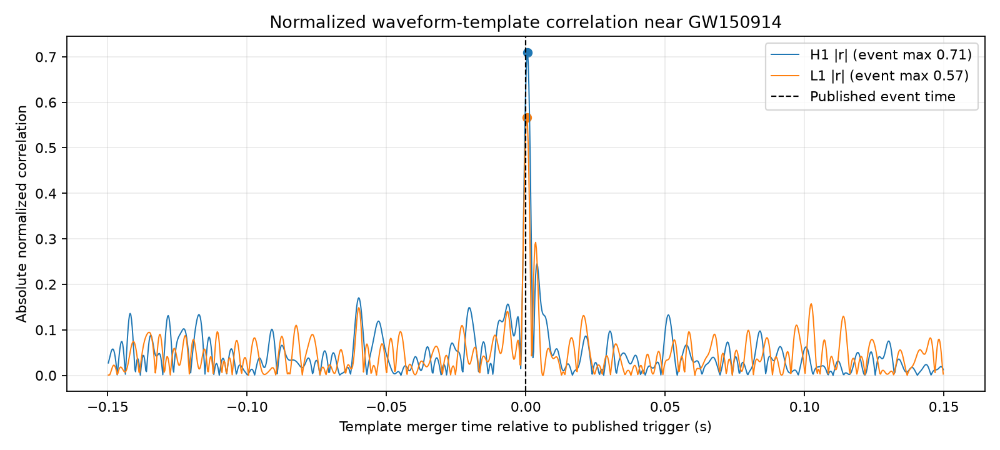
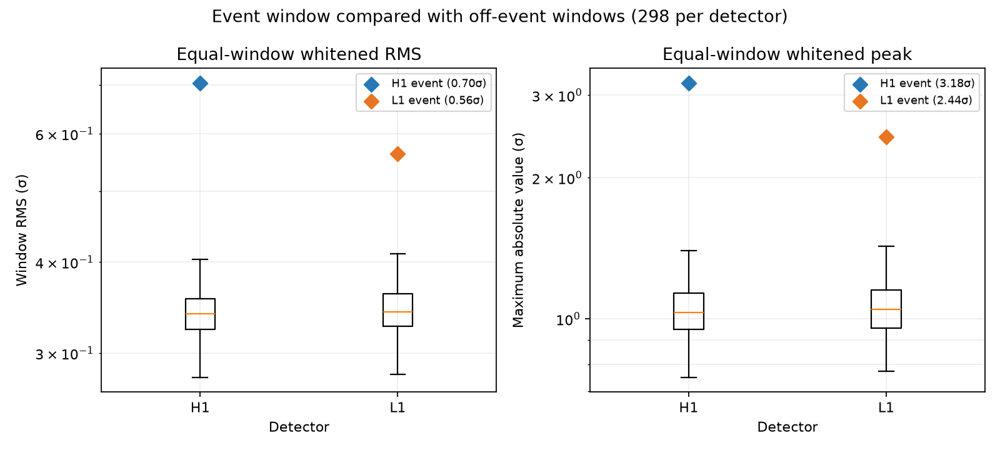

# Gravitational-Wave Signal and Detector Noise

An exploratory, reproducible analysis of the public GW150914 strain data from the two LIGO detectors, Hanford (H1) and Livingston (L1).

## Research questions

1. How does the event-centered strain compare with same-length off-event windows in each detector?
2. How does whitening account for frequency-dependent detector noise?
3. Do the two detectors show a similar short transient near the published GPS time?

This is a portfolio analysis of one known event, not a new detection claim or a validated alarm system. The notebook/script documents the processing choices and their limitations.

## Data

The project uses the 32-second, 4 kHz GWOSC HDF5 files for GW150914 (GPS trigger 1126259462.422), for H1 and L1, plus the public numerical-relativity waveform template linked from the GWOSC tutorial. The download script fetches these source files; they are not committed to Git and are saved in `data/raw/` when needed.

Source: [GWOSC API](https://gwosc.org/api/) and the [GW150914 event release](https://gwosc.org/eventapi/json/GWTC-1-confident/GW150914/v3/).
Please cite the GWOSC data release and follow its [acknowledgement guidance](https://gwosc.org/acknowledgements/). GWOSC data are released under CC BY 4.0.

## Run locally (Windows PowerShell)

```powershell
python -m venv .venv
.\.venv\Scripts\Activate.ps1
python -m pip install -r requirements.txt
python src\analyze_event.py
```

Outputs are written to `reports/` and `reports/figures/`.

## Analysis approach

- Estimate a Welch PSD from the 32-second data segment; whiten in the frequency domain and band-pass 20–300 Hz.
- Compare a 0.20-second event window with 298 same-length off-event windows stepped every 0.10 seconds.
- Whiten the tutorial's numerical-relativity waveform with each detector's PSD, then compute a normalized time-slide correlation around the published trigger and compare it with off-event slides.
- Read the embedded data-quality and hardware-injection flags; the L1 segment has a continuous-wave hardware-injection flag set.
- For a two-detector visualization, shift L1 forward by 7 ms and invert its sign, following the educational GWOSC event tutorial. This is a display adjustment, not a delay fitted by the project.
- Report empirical ranks only; overlapping background windows do not provide independent trials or a calibrated false-alarm probability.

## Preliminary result

After whitening, the event-window RMS ranked above 99.3% of H1 background windows and 97.7% of L1 background windows in this short segment. The event peak ranked at 99.3% for H1 and 98.3% for L1. These empirical ranks are **not** p-values or false-alarm probabilities: the windows overlap and the noise is nonstationary.

The normalized numerical-relativity template correlation peaked at **0.709** for H1 and **0.567** for L1, within 1 ms of the published trigger in each aligned series. The event-window template correlation was larger than every sampled off-event slide in this 32-second segment. The slides overlap heavily, and the template is a single educational waveform, so this result is a consistency check rather than a calibrated significance claim.







Data-quality flags `DATA`, `CBC_CAT1`, and `CBC_CAT2` pass for both detectors. L1's `NO_CW_HW_INJ` flag is not passed, indicating a continuous-wave hardware injection in the segment; see [initial results and caveats](reports/initial_results.md).

## Current status

The official API and both detector files have been checked. The script has run and generated the summary table, detector plots, and two-detector comparison. The notebook and `reports/initial_results.md` summarize the exploratory result and its limitations. The project is not yet published to GitHub.
