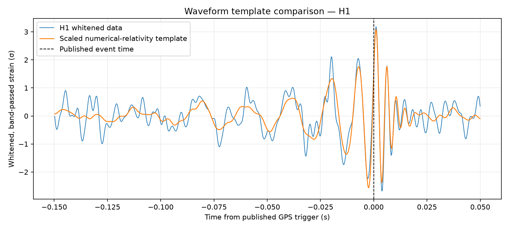
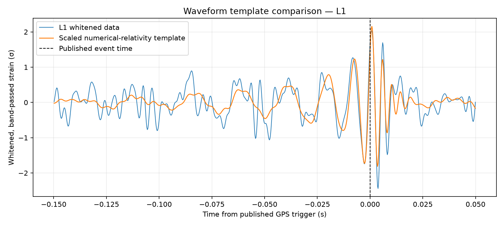

# Initial results: GW150914

## Method

The analysis uses the 32-second, 4096 Hz GWOSC strain series for Hanford (H1) and Livingston (L1). For each detector, a Welch power spectral density is estimated from the same data segment using one-second windows with 50% overlap. The strain is whitened in the frequency domain using that PSD and then band-passed from 20 to 300 Hz.

The event window is 0.20 seconds wide and centered at the published trigger time, GPS 1126259462.422. The background consists of 298 windows of the same length, stepped every 0.10 seconds, whose centers are more than one second from the event. The overlapping windows are useful for an exploratory empirical rank, but they are not independent trials.

The HDF5 quality metadata show that the `DATA`, `CBC_CAT1`, and `CBC_CAT2` flags pass throughout both files. The L1 injection metadata do not pass `NO_CW_HW_INJ`, indicating a continuous-wave hardware injection in that detector during this segment. This is an additional caveat for interpreting L1's noise spectrum.

## Event versus background

| Detector | Event whitened RMS (σ) | Background median RMS (σ) | Event RMS percentile | Event peak percentile |
| --- | ---: | ---: | ---: | ---: |
| H1 | 0.704 | 0.340 | 99.3% | 99.3% |
| L1 | 0.564 | 0.342 | 97.7% | 98.3% |

The percentiles report where the event-window statistic falls within these 298 off-event windows. They are not p-values, false-alarm rates, or detection probabilities: the windows overlap, the background is short, and detector noise is nonstationary.

## Numerical-relativity template comparison

The public educational numerical-relativity waveform was whitened with each detector's PSD and band-passed in the same range. A normalized cross-correlation was evaluated as the template slides over the data. For the event statistic, the absolute correlation was maximized when the template's merger time was within ±0.05 seconds of the published trigger; background scores were sampled every 0.10 seconds outside ±1 second.

| Detector | Peak normalized correlation | Best template merger offset | Rank among sampled off-event slides |
| --- | ---: | ---: | ---: |
| H1 | 0.709 | +0.0006 s | higher than all 293 slides |
| L1 | 0.567 | +0.0004 s | higher than all 293 slides |

The event score exceeds every sampled off-event score in this segment, but that does not provide a calibrated false-alarm probability. The background slides overlap heavily, the data span only 32 seconds, the template is a single educational waveform, and L1 has a continuous-wave injection flag set. The correlation is a useful signal-model consistency check, not a discovery claim.

For visual comparison, the best-fit scale of the template is overlaid on each detector's whitened time series:

## Two-detector view

The H1 and L1 whitened series show a similar short transient near the published event time. For visualization, L1 is shifted forward by 7 ms and sign-inverted, following the educational GWOSC event tutorial. This is a reference-based display adjustment, not a delay estimated by this project.

## Interpretation and next step

After accounting for the detector noise spectrum, the event-centered RMS and peak are high relative to most same-length windows in this short segment, and the two displayed traces have a similar shape near the trigger. This is a useful exploratory consistency check for a known event. The L1 injection flag and the short, overlapping background make stronger statistical claims inappropriate. A real search would need longer off-source data, quality checks, a full template bank with a calibrated matched-filter pipeline, and a false-alarm estimate. This project does not claim an independent detection.

## Reproduce

Run `python src/analyze_event.py`. It downloads the public H1/L1 files if missing and regenerates the summary CSV and figures. The raw files are excluded from Git and can be fetched from the official [GWOSC event release](https://gwosc.org/eventapi/json/GWTC-1-confident/GW150914/v3/).

The whitening, numerical-relativity waveform, and illustrative 7 ms alignment follow the [GWOSC GW150914 signal-processing tutorial](https://gwosc.org/s/events/GW150914/GW150914_tutorial.html). GWOSC notes that this older tutorial is educational; this project cites it as a processing reference, not as validation of these portfolio results.
